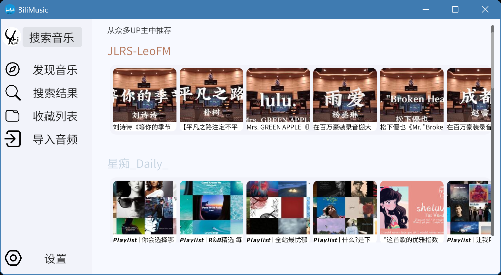
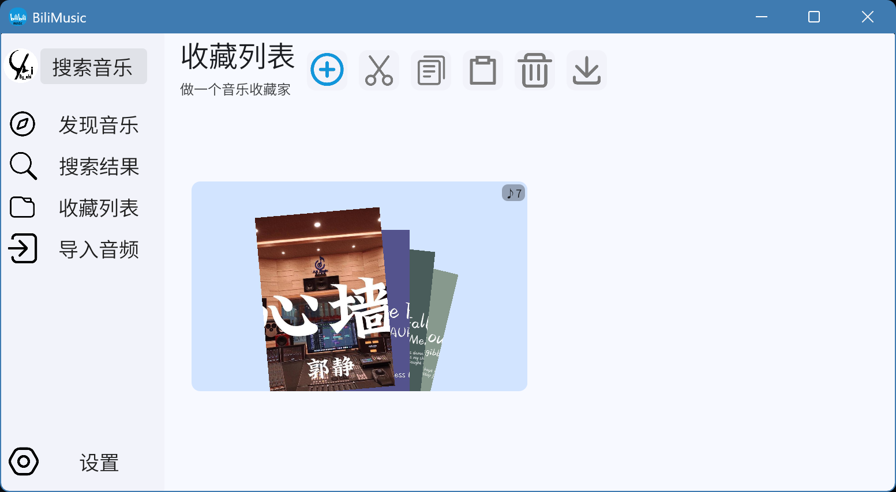
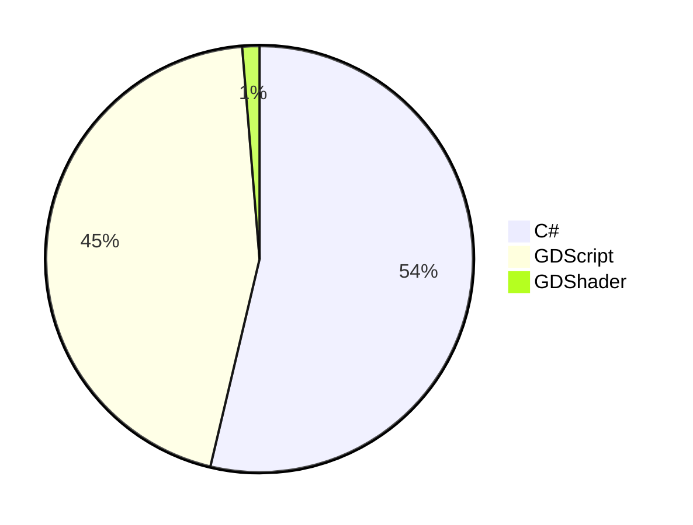

# BiliMusic

> 让音乐变得更方便 Make Music Simpler

`BiliMusic` 是一个使用 `Godot` 引擎开发的桌面应用程序，提供直接从哔哩哔哩平台流媒体播放音乐的无缝体验。它结合了 `Godot` 跨平台的强大功能与 `C#` 脚本和 `GDScript`，提供直观且高效的用户界面。

### 主要功能

- **丰富的视频流**: 支持访问哔哩哔哩平台中所有视频
- **丰富的多平台支持**: 基于 `Godot`开发，支持 `Windows`、`macOS`
- **丰富的多语言支持**: 支持`日语`、`中文`与`英语`
- **丰富的皮肤**: 支持$5$种皮肤、$3$种主题
- **快速的响应**: 高效的性能表现，使用 `GDShader` 优化渲染
- **直观高效的缓存管理**: 支持在设置中释放歌曲缓存

### 项目截图



### 安装

#### 从源代码
> $!\space>$ 重要提示 $<\space!$
> 
> 当`调试项目`时，请更改项目中
> `CSharp\Play\AudioConverter.cs`
> `DebugFfmpegPath`与`DebugFfprobePath`常量字段为实际位置
> ```csharp
> #if DEBUG
>     private const string DebugFfmpegPath = @"D:\MSYS2\home\By.chi\ffmpeg-master\ffmpeg.exe";
>     private const string DebugFfprobePath = @"D:\MSYS2\home\By.chi\ffmpeg-master\ffprobe.exe";
> #endif
> ```

1. 克隆仓库：
```bash
git clone https://github.com/By-chi/BiliMusic.git
cd BiliMusic
```
2. 在 `Godot Engine 4.7 mono` 中打开项目
3. 构建并运行项目

#### 从预编译二进制文件
 从[最新版本](https://github.com/By-chi/BiliMusic/releases)页面获取`Mac`或`Windows`版本

### 使用方法
> $!\space>$ 重要提示 $<\space!$
> 如非特殊需求，否则`强烈建议`使用哔哩哔哩账号登录，会带来更好的使用体验与更少的`412`风控报错!
1. 启动 `BiliMusic`
2. 使用`哔哩哔哩`账号登录（如需要）
3. `浏览`和`搜索`音乐
4. `点击播放、创建播放列表，享受音乐！`

### 配置

可以在设置面板中调整配置选项。主要选项包括：

- 管理登陆账号
- UI 主题选择
- 多语言选择
- 清除歌曲与封面缓存

### 开发

#### 技术栈


#### 开发需求
|名称|支持|下载链接|
|---|---|---|
|`Godot Engine 4.7 mono`|`GDScript`与`GDShader`支持|[Git下载](https://github.com/godotengine/godot)|
|`.NET Runtime`|`C#`支持|[微软下载](https://dotnet.microsoft.com/zh-cn/download)|
|`FFmpeg`|视频流支持|[Git下载](https://github.com/FFmpeg/FFmpeg)|

#### 关于贡献
欢迎贡献！可随时提交`Pull Requese`或为`bug`/`Feature`提交`Issues`。

#### 性能指标
- 平均内存占用: ~$400$ MB

### 鸣谢

- 由 [Godot Engine](https://godotengine.org/) 构建
- 音乐数据由哔哩哔哩提供

### 支持

如有问题、疑问或建议：

- `邮箱`$:$ 
- > [by.chi](mailto:by.chi@outlook.com)
- > [GeekApple](mailto:huangyuguang2013@163.com)
- `Bug`$:$
- > [GitHub Issues](https://github.com/By-chi/BiliMusic/issues)
- > [Pull Requests](https://github.com/By-chi/BiliMusic/pulls)